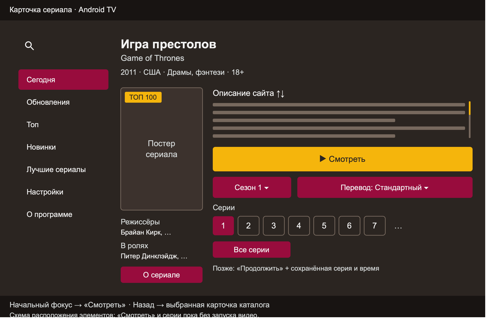

# ADR-0027: Карточка сериала для Android TV

Дата: 2026-11-02

Статус: Компоновка и начальный фокус пересмотрены в [ADR-0028](0028-site-like-series-details.md). Остальные правила выбора, загрузки и заглушки просмотра сохраняются.

## Контекст

Карточка должна сохранять содержание оригинального Seasonvar и учитывать управление пультом. Вместо встроенного плеера нужна кнопка просмотра. Рекомендации и комментарии пока исключены. Пользователь уточнил: описание берём полностью с сайта, кнопка называется «Смотреть», интерфейс готовим к будущему продолжению с сохранённых серии и времени.

2026-11-02 анонимно проверены страницы [«Игры престолов», сезон 1](https://seasonvar.ru/serial-2219--He_vse_starki_umrut----_psxskbl-00001---sezon.html) и [«Хмельного сна»](https://seasonvar.ru/serial-50920-Hmel_noj_son.html). Просмотрена статическая HTML/CSS-вёрстка первой без JavaScript и плеера. Подтверждены описание, оригинальное название, жанры, возраст, страна, год, режиссёры, актёры, ссылки на сезоны, варианты перевода и объект `arEpisodes` со списками серий. Эти данные не доказывают доступность нативного видео.

## Решение

Карточка занимает правую часть вместо каталога; меню остаётся слева. Каталог сохраняет выбранный элемент и позицию. Возврат из карточки восстанавливает фокус на исходном элементе, даже после смены сезона внутри карточки.

[Редактируемая SVG-схема](diagrams/0027-series-details.svg). Изображение показывает компоновку, постер и текст условные.

- Сверху русское название (оригинальное при отсутствии русского), ниже оригинальное и компактная строка года, страны, жанров, возраста. Отсутствующие значения не заменять вымышленными.
- Слева постер и короткие строки режиссёров/актёров. Кнопка «О сериале» открывает прокручиваемые полные метаданные и состав; актёры — текст без переходов на отдельные страницы.
- Справа **полное описание из абзацев сайта**, без сокращения до трёх строк и отдельного раскрытия. Оно занимает ограниченную по высоте область с самостоятельной прокруткой D-pad и мышью. Длинный текст не вытесняет основные действия. «О сериале» не требуется для чтения сюжета.
- Под описанием широкая кнопка **«▶ Смотреть»**, без номера серии. Начальный фокус на ней. Нажатие в текущем прототипе ничего не воспроизводит.
- Далее **сезон** и **перевод**. Выбор открывает прокручиваемый диалог с радиокнопками. Один доступный вариант показывается текстом без отдельной точки фокуса. Подписи переводов повторяют сайт: «Стандартный», «Субтитры», «Трейлеры» могут обозначать режим, а не студию озвучки.
- Ниже горизонтальная лента всех серий выбранного перевода, без искусственного ограничения количества. Фокус меняет выбранную серию. Нажатие на серию сейчас только сохраняет выбор; при подключении плеера оно будет сразу запускать эту серию.
- «Все серии» открывает ленивую сетку на текущем эпизоде, чтобы быстро добраться до дальних серий. Нажатия в ней пока также не запускают видео.

Первый экран рассчитан на 960×540dp. При недостаточной высоте или увеличенном шрифте правая часть прокручивается, меню остаётся неподвижным. Общие цвета и размеры берутся из темы по ADR-0008.

## Состояние выбора и будущее продолжение просмотра

Страница открывается именно на сезоне из каталога или поиска. Начальный перевод — активный вариант сайта, затем `0`, затем первый доступный; начальная серия — первая из его списка. Порядок серий определяется связями `next` в `arEpisodes`, а не порядком ключей JSON. Поддерживаются объект по ID перевода и массив с переводами по индексам; при единственном неявном варианте `0` показывается «Стандартный». После смены сезона загружается его страница и выбирается первая доступная серия. После смены перевода сохраняется метка эпизода, если она есть в новом списке, иначе выбирается первый.

Состояние карточки отделено от исходного элемента каталога и содержит сезон, перевод, серию и отдельное необязательное поле продолжения: сезон, перевод, серия и позиция в миллисекундах. Сейчас поле продолжения пустое: вход и чтение отметок ещё не реализованы. Ни локальный фокус, ни нажатие заглушки не создают отметку аккаунта.

В будущем подтверждённая отметка позволит заменить главное действие на «Продолжить» и показать серию/время рядом с ним. Точный сценарий выбора между продолжением и просмотром сначала уточним при реализации истории. До этого интерфейс не показывает вымышленный прогресс. Для реального запуска нужно подтвердить плейлист, видеопоток и контракт сохранения позиции; Media3 остаётся принятым плеером по ADR-0002.

## Навигация и загрузка

Начальный фокус — «Смотреть»; вверх — область описания, вниз — доступные селекторы и серии. В описании вверх/вниз прокручивают текст; вниз в конце возвращает к главному действию. Между селекторами и сериями действуют направления D-pad. На правой границе ленты фокус останавливается. Влево с границы действий можно перейти в меню, его пункты сразу открывают раздел.

Esc и «Назад» сначала закрывают вложенный диалог с восстановлением фокуса, затем карточку с возвратом к исходной миниатюре. Общий принцип двойного «Назад» сохраняется по ADR-0013. Отдельных кнопок «Назад» нет.

HTML и данные разбираются вне главного потока. Карточка использует тот же суточный кэш страницы, что и описание каталога. Смена сезона отменяет предыдущий запрос; устаревший ответ не заменяет новый выбор. Перевод меняет список из уже загруженных данных. Отсутствие данных серий, подтверждённый пустой список и ошибка страницы — разные состояния. Сетевые, HTTP-ошибки и изменение разметки различаются; доступна повторная загрузка.

## Альтернативы и последствия

Маленький диалог не вмещает выбор просмотра. Встроенный WebView-плеер добавляет тяжёлую инициализацию и не решает нативное воспроизведение. Одна длинная страница уводит основные действия ниже первого экрана; вместо неё полное описание прокручивается в выделенной области.

Появляются модель метаданных и независимое состояние карточки. Парсеры проверяются обезличенными фикстурами без аккаунта, плейлистов и подписанных видеоссылок. Навигация требует проверки пультом. Связанные решения: [ADR-0006](0006-tv-navigation-and-content-layout.md), [ADR-0013](0013-navigation-without-back-buttons.md), [ADR-0014](0014-restore-list-focus-after-details.md), [ADR-0015](0015-settings-item-format.md), [ADR-0025](0025-responsive-section-switching.md).
